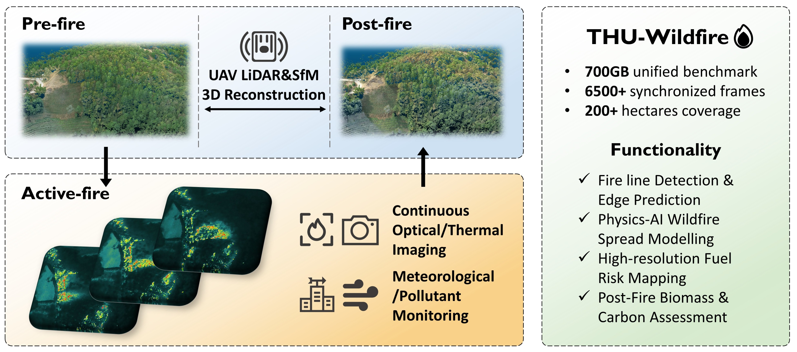

<h1 align="center"> <p> THU-Wildfire </p></h1>
<p align="justify">
We introduce THU-Wildfire, the first integrated dataset of multitemporal and multimodal observations from four wildfire events. It combines photogrammetry and 3D point cloud reconstruction before and after fires, continuous visible-light and thermal infrared images during fire events, time-series records of pollutant concentrations (PM2.5, CO, etc.) and meteorological parameters (wind speed, temperature, humidity, etc.).
</p>



## 🚗Download
**Please fill out this [form](https://docs.google.com/forms/d/e/1FAIpQLScydu7G5nZO5ayeeiqmlQ8ibHu5O4VBuN8V4qvV8LEaV54pkQ/viewform?usp=sharing&ouid=118271888753834723056) to get the download link.**

## 🆕 News
* 2026-07: Our paper is accepted by **JAG** [[Link]](https://www.sciencedirect.com/science/article/pii/S1569843226003894)🎉
* 2026-01: Our paper is accepted by **EMS** [[Link]](https://www.sciencedirect.com/science/article/pii/S1364815226000198)🎉!
* 2025-05: Data of *Ninuo* region has been released!

## 🔢Data Structure

```
Region name
├── Pre-fire&Post-fire
│    ├── Pre-fire
│    │    ├── LiDAR
│    │    │    └── Pointcloud.las
|    |    └── Photogrammetry
│    │         ├── DSM.tif
│    │         └── Orthophoto.tif
│    └── Post-fire
│         └── ...
│       
├── Pollutant&Weather
│    ├── Station1.csv
│    ├── Station2.csv
│    └── ...
│
├── Active-fire
│    ├── Image
│    │    ├── Annotation
│    │    │    ├── 000016.png    
│    │    │    └── ...
│    │    ├── InfraredJPG
│    │    │    ├── 000001.jpg
│    │    │    └── ...
│    │    ├── Optical
│    │    │    ├── 000001.jpg
│    │    │    └── ...  
│    │    ├── Optical_projected
│    │    │    ├── 000001.tif
│    │    │    └── ...      
│    │    ├── ThermalTIFF
│    │    │    ├── 000001.tif
│    │    │    └── ...       
│    |    └── ThermalTIFF_projected
│    │         ├── 000001.tif
│    │         └── ...
│    └── Video
│         └── ...
│
└── Landscape
     └── LCP.tif
```

* Please note that all geographic coordinates have been offset.
* For the complete video file, please contact me to obtain it.
* Detailed technical parameters will be disclosed in our paper.

## 📚Citation
```
@article{ZhouTHUFire2026,
     title = {THU-Wildfire: A Multitemporal, Multimodal Observation Dataset for Wildfire Behavior Dynamics},
     journal = {Environmental Modelling & Software},
     pages = {106872},
     year = {2026},
     issn = {1364-8152},
     doi = {https://doi.org/10.1016/j.envsoft.2026.106872},
     author = {Jiahao Zhou and Sen He and Shanjunxia Wu and Jia Zhang and Qiuhua Wang and Fei Wang}
}

@article{ZhouSpread2026,
     title = {Integrating UAV image time-series with multi-source environmental features for sequential wildfire spread prediction},
     journal = {International Journal of Applied Earth Observation and Geoinformation},
     volume = {152},
     pages = {105473},
     year = {2026},
     issn = {1569-8432},
     doi = {https://doi.org/10.1016/j.jag.2026.105473},
     author = {Jiahao Zhou and Sen He and Shanjunxia Wu and Qiuhua Wang and Fei Wang},
     }
```
